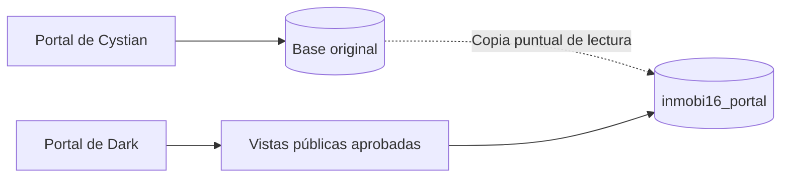
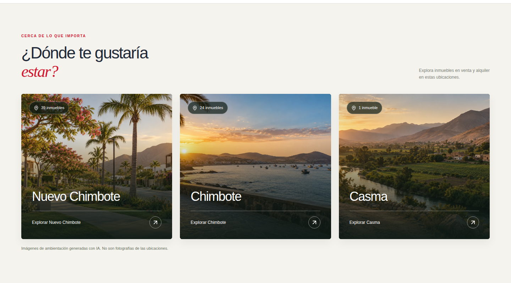

# Portal Alfaro · Avances de fase 3

Continuación del 21 de octubre: [Seguridad, auditoría real y respaldo cifrado](CONTINUIDAD-FASE-3-SEGURIDAD-2026-10-21.md). Cambios preparados en rama; no equivalen a cierre de fase 3 ni a publicación en Production.

> **Corte de esta entrega:** 21 de octubre de 2026, UTC.
>
> **Estado:** nueva base integrada en Production y sección de ubicaciones rediseñada.
>
> **Fase 3:** avance parcial; quedan tareas de calidad de datos, operación y seguridad.
>
> **Fase 4:** integración con intranet pendiente.

| Referencia | Ubicación |
| --- | --- |
| Portal de Dark | [app-alfaro-git-smoky.vercel.app](https://app-alfaro-git-smoky.vercel.app) |
| Repositorio de trabajo | [darkcystian15-rgb/app-alfaro-git](https://github.com/darkcystian15-rgb/app-alfaro-git) |
| Base de trabajo y conexión actual de Dark | `inmobi16_portal` |
| Rama publicada | `main` |
| Integración de base | [`ace86f8`](https://github.com/darkcystian15-rgb/app-alfaro-git/commit/ace86f87b481f92e869d9bbe4f6f19eee2a6a5a6) |
| Rediseño de ubicaciones | [`0a6bf01`](https://github.com/darkcystian15-rgb/app-alfaro-git/commit/0a6bf01062fbee85292195b96f431c9e6e6bff16) |

## Contenido

1. [Resultado de la entrega](#1-resultado-de-la-entrega)
2. [Independencia respecto de Cystian](#2-independencia-respecto-de-cystian)
3. [Datos copiados y verificados](#3-datos-copiados-y-verificados)
4. [Mejoras de estructura](#4-mejoras-de-estructura)
5. [Integración del portal](#5-integración-del-portal)
6. [Rediseño de ubicaciones](#6-rediseño-de-ubicaciones)
7. [Pruebas y despliegues](#7-pruebas-y-despliegues)
8. [Pendientes y siguiente etapa](#8-pendientes-y-siguiente-etapa)
9. [Respaldo y recuperación](#9-respaldo-y-recuperación)
10. [Archivos de referencia](#10-archivos-de-referencia)

## 1. Resultado de la entrega

El portal de Dark ya trabaja con una base independiente, poblada con los datos existentes y preparada para introducir mejoras sin escribir sobre la base activa de Cystian. Las APIs de inmuebles utilizan vistas públicas que respetan el estado de publicación. Se conservaron los IDs y las rutas de las fichas.

También se renovó la sección **«CERCA DE LO QUE IMPORTA / ¿Dónde te gustaría estar?»** con tres imágenes generadas, tarjetas que ocupan todo el ancho disponible y enlaces a los inmuebles de cada ubicación.

### Estado comprobado al cierre

- [x] Acceso de Vercel renovado y proyecto correcto verificado.
- [x] Permisos MySQL comprobados.
- [x] Nueva base creada desde cPanel por el usuario y acceso asignado.
- [x] Datos copiados con verificación de contenido.
- [x] Relaciones, restricciones y vistas incorporadas en la nueva base.
- [x] APIs adaptadas y probadas contra MySQL.
- [x] Conexión de Production de Dark actualizada.
- [x] Código publicado y despliegues verificados como `READY`.
- [x] Portal comprobado en navegador, incluidos PDF y JPG.
- [x] Imágenes y rediseño de ubicaciones publicados y verificados.
- [ ] Reparaciones ambiguas de datos y correspondencias de catálogos.
- [ ] Usuario exclusivo con permisos mínimos y respaldo permanente con restauración probada.
- [ ] Sincronización autorizada con intranet, correspondiente a fase 4.

## 2. Independencia respecto de Cystian

La cuenta MySQL tenía permisos sobre bases concretas, pero el intento inicial de crear otra base devolvió `1044 / ER_DBACCESS_DENIED_ERROR`. El usuario creó `inmobi16_portal` desde cPanel y asignó los permisos necesarios. A partir de ese momento se trabajó en el destino autorizado.

| Elemento | Resultado |
| --- | --- |
| Base original | Se utilizó como origen de lectura; no se modificó en esta entrega. |
| Portal de Cystian | Su proyecto y configuración de conexión no se modificaron. |
| Portal de Dark | Su variable `DB_NAME` de Production apunta a `inmobi16_portal`. |
| Preview | No se ampliaron variables de Production a Preview. |
| Cambios futuros | No se replican automáticamente entre ambas bases. |
| Archivos de fotos | Se conservaron sus rutas; no se duplicó el almacenamiento. |

**Límite de aislamiento:** las bases son independientes, pero el usuario MySQL compartido conserva acceso a ambas. Un usuario exclusivo del nuevo portal continúa pendiente.

## 3. Datos copiados y verificados

La copia del origen se leyó dentro de una transacción `READ ONLY`, con instantánea coherente. Las escrituras se realizaron únicamente en la nueva base.

| Tabla original | Filas copiadas | Columnas originales verificadas |
| --- | ---: | --- |
| `properties` | 64 | Coincidencia exacta |
| `sub_properties` | 446 | Coincidencia exacta |
| `mas_info` | 134 | Coincidencia exacta |
| `distritos` | 10 | Coincidencia exacta |
| `modalidades` | 2 | Coincidencia exacta |
| `tipos` | 7 | Coincidencia exacta |
| `asesores` | 7 | Coincidencia exacta |
| `articulos` | 4 | Coincidencia exacta |
| `noticias` | 4 | Coincidencia exacta |
| `redes_sociales` | 4 | Coincidencia exacta |
| **Total** | **682** | **Diez tablas verificadas** |

La validación comparó mediante SHA-256 las filas ordenadas por ID y todas las columnas originales contra la instantánea leída. No fue únicamente una comparación de conteos.

Se preservaron importes, textos, IDs, referencias heredadas y rutas. Los 446 registros de galería no se presentan como 446 archivos descargados o comprobados: esa revisión no se ejecutó.

## 4. Mejoras de estructura

La nueva base tiene **14 tablas y 3 vistas públicas**: las diez tablas heredadas, cuatro tablas nuevas y las proyecciones para el portal.

### 4.1 Moneda y condición del precio

Se añadió el catálogo `currencies`, con USD y PEN, y los campos `properties.currency_code` y `properties.price_basis`.

| Valor heredado | Moneda canónica | Condición adicional |
| --- | --- | --- |
| `US$`, con o sin espacios exteriores | `USD` | Sin condición inferida |
| `S/`, con o sin espacios exteriores | `PEN` | Sin condición inferida |
| `US$ c/u` | `USD` | `per_unit` |

No se convirtieron importes ni se reemplazó `moneda`. La representación **«c/u»** se conserva al mostrar el precio y ahora se reconoce como USD en los filtros y la comparación. Ningún inmueble quedó con moneda canónica sin reconocer en la copia comprobada.

### 4.2 Relaciones y catálogos

- Se incorporaron siete claves foráneas en el destino.
- `property_type_id`, `modality_id` y `district_id` permiten futuras correspondencias verificadas con los catálogos; permanecen sin asignación cuando no existe evidencia suficiente.
- Galería e información adicional tienen `property_ref_id` con relación al inmueble.
- Las referencias antiguas permanecen disponibles para conservar trazabilidad.
- Se restringe el borrado de inmuebles referenciados; no se introdujo eliminación automática en cascada.

### 4.3 Control de publicación

`publications` separa la publicación de las modalidades venta/alquiler y del indicador destacado.

| Estado | Visibilidad en las vistas públicas |
| --- | --- |
| `pending_review` | Oculto |
| `published` con `approved_at` | Visible |
| `suspended` | Oculto |
| `withdrawn` | Oculto |

La primera copia dejó las 64 publicaciones pendientes. Durante la integración se aprobó la transición de **los mismos 64 IDs que el portal ya mostraba públicamente**, conservando los 8 destacados. Esto preserva el catálogo existente; no autoriza automáticamente futuras publicaciones procedentes de intranet.

### 4.4 Restricciones e índices

Se añadieron seis restricciones `CHECK`: precio no negativo, área no negativa, condición de precio conocida o nula, coincidencia de referencias en galería, coincidencia de referencias en información adicional y fecha de aprobación obligatoria para publicar.

Se incorporaron índices de ensayo para galería, información adicional y orden del catálogo por fecha/destacado. **No se atribuye una mejora de rendimiento medida:** las pruebas confirman funcionamiento, no una comparativa de carga antes/después.

### 4.5 Incidencias conservadas para revisión

| Hallazgo | Cantidad registrada | Tratamiento aplicado |
| --- | ---: | --- |
| Galería sin inmueble relacionado | 6 filas | Conservadas; nueva referencia nula e incidencia registrada. |
| Área igual a cero | 4 inmuebles | Valor conservado; revisión pendiente. |
| Dirección vacía | 2 inmuebles | Valor conservado; revisión pendiente. |
| Filas involucradas en órdenes de galería repetidos | 24 filas | Conservadas; desempate por ID en la API. |

Las 24 filas no equivalen a 24 grupos duplicados. No se borraron huérfanos, no se renumeraron galerías y no se completaron direcciones o áreas por suposición.

`migration_issues` conserva los casos detectados y `migration_runs` registra resultados agregados de la copia inicial.

## 5. Integración del portal

| API | Fuente actual de inmuebles | Comportamiento conservado |
| --- | --- | --- |
| `/api/getProperties` | `public_properties` | Listado, destacados y filtros existentes |
| `/api/getPropertyDetails` | `public_properties` y `public_property_gallery` | Respuesta `{ property, subProperties }` |
| `/api/getPropertyDetailInfo` | `public_property_info` | Lista de información adicional |
| `/api/property-share` | `public_properties` | HTML social, JPG y descarga |

Las APIs editoriales y de opciones consultan sus tablas equivalentes en la nueva base. Se mantuvieron las rutas `/propiedades/resumen/:id` y los enlaces utilizados por PDF, QR y compartir.

Las vistas enumeran sus columnas públicas y excluyen `propietario` y referencias internas de integración. También se retiraron mensajes internos MySQL de las respuestas de error de las APIs de inmuebles modificadas.

Las respuestas de inmuebles y compartir usan `Cache-Control: no-store`. Esto evita reutilización HTTP futura de esas respuestas por cachés conformes; no elimina copias guardadas previamente por redes sociales u otros servicios externos.

**Alcance real:** las vistas y las APIs aplican la regla, pero una cuenta con permiso de lectura directa sobre las tablas puede acceder a los campos heredados privados. Por ello sigue siendo necesario limitar privilegios antes de ampliar integraciones.

## 6. Rediseño de ubicaciones

### Resultado publicado

Se conservaron el título y el estilo del portal, renovando el contenido visual de la sección.

| Antes | Ahora |
| --- | --- |
| Tarjetas de colores sin imágenes | Tres ambientaciones visuales generadas |
| Tres tarjetas dentro de una rejilla de cuatro columnas | Tarjetas que aprovechan el ancho disponible |
| Nombres y flecha como acción | Nombre, conteo y «Explorar [ubicación]» |
| Poca diferencia visual entre lugares | Avenida residencial, bahía costera y valle agrícola |

Los conteos se calculan desde el catálogo público. Al verificar esta entrega se mostraron **39 inmuebles en Nuevo Chimbote, 24 en Chimbote y 1 en Casma**; no se fijaron esos números en el componente.

### Adaptación y accesibilidad

- Tres columnas en escritorio y tablet; una columna en móvil pequeño.
- Textos blancos sobre degradado oscuro para legibilidad.
- Imágenes optimizadas a WebP de 1200 × 800 píxeles, con carga diferida.
- Foco de teclado visible y compatibilidad con movimiento reducido.
- Cada tarjeta abre el catálogo con su ubicación seleccionada.
- Aviso visible: imágenes de ambientación generadas con IA, no fotografías de las ubicaciones.

Las imágenes se crearon mediante la herramienta integrada `image_gen`. Son composiciones referenciales y no documentan lugares ni inmuebles concretos.

| Archivo del repositorio | Uso |
| --- | --- |
| `public/portal/location-nuevo-chimbote-v1.webp` | Ambientación residencial |
| `public/portal/location-chimbote-v1.webp` | Ambientación costera |
| `public/portal/location-casma-v1.webp` | Ambientación de valle |

[Ver captura móvil](evidencia-fase3/ubicaciones-movil.png) · [Consultar prompts y procedencia](IMAGENES-UBICACIONES-GENERADAS.md)

## 7. Pruebas y despliegues

### 7.1 Comprobaciones ejecutadas

| Capa | Comprobación | Resultado |
| --- | --- | --- |
| Copia de datos | Diez tablas, 682 filas y columnas originales | Coincidencia exacta |
| Integridad | Relaciones, aprobación y rechazo de precio negativo | Correcto |
| Pruebas existentes | `npm test`, tres archivos | Aprobados |
| Compilación | Vite de integración y Vite del rediseño | Correctas |
| Integración MySQL | 64 fichas y sus galerías/información; filtros y APIs editoriales | Correcto |
| Visibilidad | Suspender oculta catálogo, detalle, información y compartir | Correcto; cambios de ensayo revertidos |
| APIs de Production | Listado, destacados, opciones, detalle, información, asesores, artículos, noticias y redes | HTTP 200 en las solicitudes comprobadas |
| IDs públicos | Comparación antes/después del cambio | Mismos 64 IDs |
| Navegador del portal integrado | Catálogo, favoritos, comparación, filtros, galerías y rutas institucionales | Correcto |
| Descargas | JPG 1200 × 630 y PDF con cabecera válida | Correcto |
| Robustez visual | Error de red, vacío, imagen rota y saneamiento de HTML | Correcto mediante fixtures aislados |
| Nuevas ubicaciones | Imágenes, conteos, enlaces y foco | Correcto |
| Adaptación de ubicaciones | 1440, 768 y 375 px | Sin desbordamiento horizontal |
| Comprobación tras publicar imágenes | Tres imágenes cargadas y navegación a Chimbote | Correcto |

La prueba completa de navegador de la integración terminó sin errores de ejecución ni envíos POST. No se enviaron consultas comerciales. La validación posterior del rediseño se concentró en la sección modificada; no se presenta como una repetición completa de todas las pruebas anteriores.

Las compilaciones conservaron avisos de Browserslist y tamaño de bundle. No impidieron compilar. No se ejecutaron pruebas de carga ni se certifica disponibilidad continua a partir de estas comprobaciones.

### 7.2 Despliegues comprobados

| Entrega | Commit | Despliegue Vercel | Estado observado |
| --- | --- | --- | --- |
| Referencia anterior | `1b7dc87` | `dpl_H6uiijyedZBY3K6ANGMqBo1hiuH9` | `READY` antes de migrar |
| Integración de BD | `ace86f8` | `dpl_2ckrqycSYPFrXjUQUhR75njU6cmR` | `READY` y dominio comprobado |
| Rediseño de ubicaciones | `0a6bf01` | `dpl_9MpwTiVDn4dof8JWmFDJyzgvxnzb` | `READY` y dominio comprobado |

El último despliegue de producto comprobado es el del rediseño. Este documento registra esa evidencia; una actualización posterior solo documental no implica una nueva modificación de producto o BD.

## 8. Pendientes y siguiente etapa

| Prioridad | Trabajo | Criterio para completarlo |
| --- | --- | --- |
| Alta | Respaldo permanente de BD y archivos | Copia fuera de `/tmp` y ensayo de restauración con evidencia. |
| Alta | Usuario exclusivo de Dark | Acceso limitado a la nueva base y a las operaciones necesarias. |
| Alta | Consumidores y escritores externos | Inventario contrastado antes de retirar funciones o rotar credenciales compartidas. |
| Alta | Credenciales históricas y diagnósticos heredados | Retirada y rotación coordinada, considerando historial Git y consumidores activos. |
| Media | Seis huérfanos de galería | Antecedente revisado y decisión documentada sobre relación o retiro. |
| Media | Áreas cero y direcciones vacías | Confirmar significado y privacidad; corregir únicamente con datos verificados. |
| Media | Correspondencias de tipo, modalidad y distrito | Identidad confirmada por inmueble y referencias completadas sin ambigüedad. |
| Media | Flujo de aprobación | Definir responsable y herramienta operativa para aprobar, suspender y retirar. |
| Condicionada | Más índices, paginación SQL o ampliación editorial | Requisito concreto y medición que justifique el cambio. |
| Fase 4 | Sincronización con intranet | Proyección pública autorizada, IDs estables, conflictos, reintentos y recuperación. |

El cambio de base no creó autenticación nueva, panel de aprobación ni sincronización automática. Tampoco cerró la revisión general de seguridad del repositorio.

## 9. Respaldo y recuperación

Antes de las mejoras se guardó una copia privada temporal de esquema y datos de la nueva base, comprobando que podía leerse y comparando su contenido. Antes de la transición se registraron el despliegue anterior, el valor previo de `DB_NAME`, los IDs públicos y los estados de publicación.

**No equivale a un respaldo operativo completo:** los archivos están en almacenamiento temporal y no se ha probado una restauración integral en otro servidor/base.

### Recuperación de la conexión anterior, si fuera necesaria

1. Consultar el registro privado del valor anterior de `DB_NAME`.
2. Restaurar ese valor únicamente en Production del proyecto de Dark.
3. Promover o recrear el despliegue anterior compatible con esa conexión.
4. Comprobar catálogo, fichas, galerías y compartir en el dominio.

Cambiar variables de proyecto no modifica el entorno de los despliegues ya existentes. Revertir código tampoco revierte una migración SQL. La base de origen se mantuvo sin escrituras durante estas tareas.

No ejecutar los scripts de creación como una actualización rutinaria: el primero exige destino vacío y el segundo contiene un ensayo pensado para publicaciones pendientes. El DDL puede producir commits implícitos y necesita un procedimiento específico de recuperación.

## 10. Archivos de referencia

| Archivo | Contenido |
| --- | --- |
| [Integración de la nueva BD](INTEGRACION-BD-PORTAL-FASE-3-2026-10-21.md) | Alcance técnico y validación previa al despliegue. |
| [Procedencia de imágenes](IMAGENES-UBICACIONES-GENERADAS.md) | Prompts finales, herramienta y archivos. |
| [Resultado de copia](evidencia-fase3/RESULTADO-PORTAL-F3-2026-10-21.json) | Conteos y coincidencia de columnas originales. |
| [Resultado de restricciones y vistas](evidencia-fase3/RESULTADO-MEJORAS-PORTAL-F3-2026-10-21.json) | Comprobaciones SQL y referencia del respaldo temporal. |
| [Resultado público de integración](evidencia-fase3/RESULTADO-INTEGRACION-PUBLICA-F3-2026-10-21.json) | APIs y navegador del portal integrado. |
| [Publicación de ubicaciones](evidencia-fase3/PUBLICACION-UBICACIONES-2026-10-21.json) | Commit, despliegue y comprobación pública. |
| [Script de copia inicial](../scripts/crear-portal-prueba-f3.mjs) | Creación y copia al destino vacío; no es sincronización. |
| [Script de mejoras](../scripts/mejorar-portal-f3.mjs) | Restricciones, vistas y ensayo transaccional. |

Los documentos de transferencia anteriores se conservan como antecedentes. Para el estado implementado al corte de esta entrega, utilizar este informe y sus evidencias. No se incluyen contraseñas, tokens ni valores personales de las tablas.
